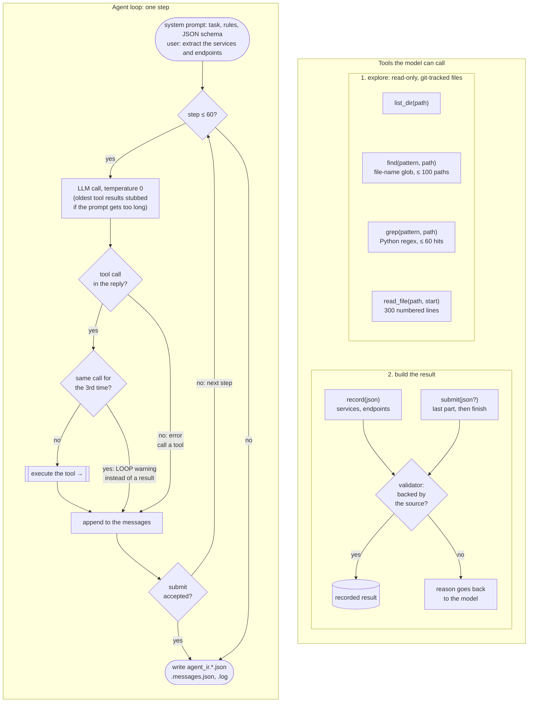
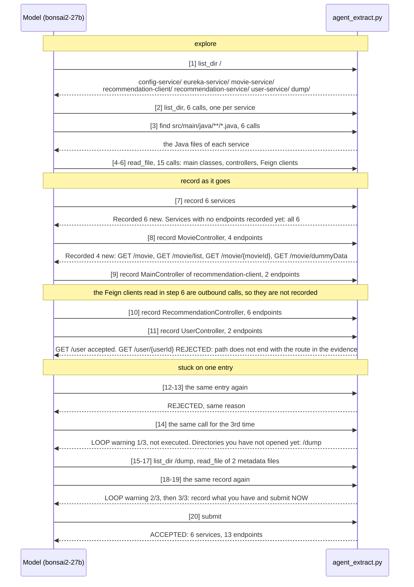

# How the agent works

`agent_extract.py` gives the model a task, a set of tools and up to 60 steps.
In each step the model calls one or more tools and gets their results back.
It builds the result piece by piece with `record`. Every piece is checked against
the source code. The run ends when the model calls `submit` and nothing is rejected.

## The loop and its tools



- **Exploration tools** see only files tracked by git, minus `node_modules` and
  `vendor`. Several checkouts can be mounted side by side as one system.
- **`record`** takes `{"services": [...], "files": [...]}`. Accepted entries
  stay in the result. A rejected entry comes back with the reason, the model
  fixes it and records it again. So a system with 50 endpoints never has to fit
  into one reply.
- **The validator** accepts an endpoint only when:
  - its file exists and lies under a directory of a recorded service,
  - `className` and `methodName` appear in that file,
  - `evidence` is found within 3 lines of `line`,
  - the HTTP verb agrees with the evidence,
  - the path ends with the route literal in the evidence.
- **`submit`** is accepted only if nothing in its last part was rejected and at
  least one service is recorded.
- **Tool call format:** with `--native-tools` the tools are sent as an OpenAI
  `tools` array, and the model may make several calls in one reply. Without it,
  the tool list is in the system prompt, and the model writes one
  `<tool_call>name<arg_key>k</arg_key><arg_value>v</arg_value></tool_call>`
  per reply.
- **Guards:** 4 steps before the limit the model is told to record what it has
  and submit. The 4th loop warning, or ignoring the order to submit, stops the
  run. An API error that persists after the retries also ends the run. Every run
  writes its output, and `_run.accepted` says whether `submit` succeeded.

## Example run

bonsai2-27b with `--native-tools --effort none` on
spring-cloud-movie-recommendation (commit `5aa5ee9e`, 93 files, 6 services).
Numbers in brackets are steps. Steps 2–6 make several calls in one reply.



What one `record` call looks like (step 8, first of its 4 endpoints):

```json
{"files": [{"path": "/movie-service/src/main/java/com/example/MovieController.java",
  "service": "movie-service",
  "endpoints": [{"className": "MovieController", "methodName": "getAllMovies",
    "httpMethod": "GET", "path": "/movie", "line": 31,
    "evidence": "@RequestMapping(method = RequestMethod.GET)",
    "framework": "Spring", "confidence": "high"}]}]}
```

The class carries `@RequestMapping("/movie")`, so the model joined that prefix
into `path`.

The rejection in step 11: the model copied the declaration as
`@RequestMapping(value="/ {userId}", ...)`, with a space that is not in the
source. The validator then compared the route with the spaces, so it rejected
the entry. Each retry sent the same text. The validator now ignores whitespace,
and the same entry passes.

**Result:** scored against the ground truth: 13 of 14 endpoints, 0 false
positives, F1 0.963. The only miss is the rejected `GET /user/{userId}`.
The run took 20 steps and 428 s. It used 177 k input tokens (168 k of them
from the prompt cache) and 3 k output tokens. The full log is in
`out/agent_ir.spring-cloud-movie-recommendation.bonsai2-27b.none.log`.
